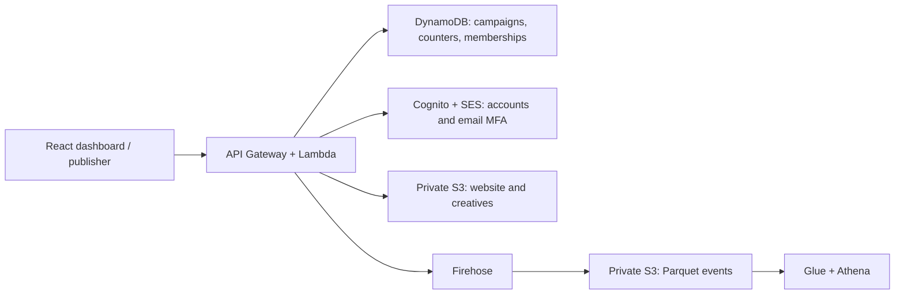

<p align="center">
  
</p>

# Pulsar

A React ad platform with campaign management, configurable account verification, consent-based fingerprint reporting, and serverless AWS analytics.

This workspace contains the reusable **`@pulsar/react-ads`** package, a **React dashboard and publisher preview**, and an **AWS SAM backend**. Run the demo locally with disposable storage or deploy the stack into your own AWS account.

> **Prototype, not a production ad network.** Public tracking endpoints have no fraud protection, event delivery is best-effort, and the spending guard is not a hard cap. Do not use these counters for billing.

[Quick start](#quick-start) · [React integration](#react-integration) · [Architecture](#architecture) · [AWS deployment](#deploy-to-aws) · [Operations](#operations)

## What’s included

| Area | Capabilities |
| --- | --- |
| Publisher integration | Weighted ad selection, sidebar and banner placements, batched events, viewability, and conversion tracking. |
| Dashboard | UTC daily metrics, campaign comparison, desktop/mobile publisher preview, and system/light/dark themes. |
| Administration | Password-based accounts, optional email confirmation/MFA, shared administrator-group enrollment, campaign editing, and creative uploads. |
| Analytics | Live DynamoDB counters, opt-in browser fingerprint reports, and on-demand Athena queries over Firehose-delivered Parquet. |
| AWS operations | Private S3 assets served over HTTPS, API throttling, seven-day logs, budget alerts, and best-effort Lambda shutdown. |

Deployment URLs and invitation keys are intentionally not published here. Removing a link is **not** access control: the deployed site and public API routes remain reachable.

## Quick start

**Requires:** Node.js 24 LTS, npm, and a running Docker daemon. No AWS credentials are needed locally.

```sh
npm install
REQUIRE_EMAIL_VERIFICATION=false npm run dev
```

Open **http://127.0.0.1:5173**. The runner creates disposable DynamoDB Local and S3Mock containers, then seeds six campaigns, eight creatives, and seven days of labeled synthetic statistics. Four campaigns start active and two paused. New interactions add real events to those local counters.

**Optional email verification and MFA:** these are enabled by default when `REQUIRE_EMAIL_VERIFICATION` is unset. To use them locally, configure a real SMTP service with TLS/STARTTLS and an authorized sender:

```sh
read -rs SMTP_URL; echo
export SMTP_URL
export SMTP_FROM='noreply@example.com'
REQUIRE_EMAIL_VERIFICATION=true npm run dev
```

The prompt keeps SMTP credentials out of shell history. Treat the URL as a secret. Email-enabled mode fails closed without both SMTP settings. The explicit `false` setting enables a password-only demo instead; it sends no account emails.

### Try the end-to-end flow

1. In **Overview**, select **Find your next adventure (`c3`)** and note its click total.
2. Open **Publisher preview** and inspect the sidebar and banner at desktop or mobile widths.
3. Click the banner to open the advertiser page in a new tab.
4. Return to **Overview** and select **Refresh data** after the event batch is recorded. The `c3` click total increases.
5. Open **Campaigns**, create an account, sign in, and join the administrator group using the local key, **`local-admin`**. With email verification enabled, complete the emailed confirmation and sign-in codes too.

**Ctrl-C deletes local data**, including accounts and group memberships. Override the local enrollment key with `ADMIN_KEY`; never reuse the local default in AWS.

<details>
<summary>Local ports and configuration</summary>

| Service | Default |
| --- | --- |
| Vite dashboard | `http://127.0.0.1:5173` |
| API | `http://localhost:3001` |
| DynamoDB Local | `127.0.0.1:8000` |
| S3Mock | `127.0.0.1:9000` |

Set `API_PORT`, `DB_PORT`, or `STORAGE_PORT` to change service ports. If changing `API_PORT`, also set `VITE_API_URL`. If Vite uses a different origin, set `LOCAL_WEB_ORIGIN` to that exact origin and `CREATIVE_BASE_URL` to the same origin followed by `/creatives`.

Original SVG creatives are served by Vite. Remove any cloud `demo/.env` override before running locally. The local analytics screen reports the AWS pipeline as unconfigured; it does not simulate Firehose or Athena.

</details>

## React integration

The package is available inside this workspace but **has not been published to npm**. React and React DOM 18 or 19 are peer dependencies.

```tsx
import { AdProvider, AdSlot, AdStats } from '@pulsar/react-ads';

export function Publisher({ apiUrl }: { apiUrl: string }) {
  return (
    <AdProvider apiUrl={apiUrl}>
      <AdSlot placement="sidebar" width={300} height={250} />
      <AdStats campaignId="c1" days={7} />
    </AdProvider>
  );
}
```

Publishers use the public ad, event, and stats routes; they do **not** need an administrator key. See the [package README](packages/react-ads/README.md) for props, conversion events, batching, consent handling, and delivery limitations.

```sh
npm run build --workspace=@pulsar/react-ads
npm pack --workspace=@pulsar/react-ads
```

## Architecture



The website Lambda serves private S3 assets through API Gateway HTTPS, without requiring CloudFront. DynamoDB is the live counter source; buffered raw analytics are separate.

### Workspace

| Path | Responsibility |
| --- | --- |
| [`packages/react-ads`](packages/react-ads) | Reusable React components, hooks, ESM/CJS builds, and TypeScript declarations. |
| [`demo`](demo) | Vite dashboard, publisher preview, account screens, and administration UI built with Tailwind and shadcn/ui. |
| [`backend/template.yaml`](backend/template.yaml) | SAM infrastructure, identity, storage, analytics, and cost controls. |
| [`backend/src/handlers`](backend/src/handlers) | Ad serving, events, stats, authentication, administration, static hosting, and shutdown handlers. |
| [`backend/analytics.sql`](backend/analytics.sql) | Example Athena queries using UTC arrival-date partitions. |
| [`scripts`](scripts) | Local runner, campaign seed, deployment, and confirmation-gated teardown. |

## Accounts and administration

1. Create an account under **Campaigns**.
2. Sign in with your password. When email verification is enabled, registration also requires email confirmation and every sign-in requires a fresh emailed code.
3. Redeem the deployment’s invitation key once to join its shared administrator group.

The registration form checks for 12–256 characters, uppercase and lowercase letters, a number, a symbol, and no spaces before submitting. These new-password checks do not restrict existing passwords at sign-in.

`REQUIRE_EMAIL_VERIFICATION=false` disables both email confirmation and email MFA for a temporary password-only demo. The account UI displays the active mode using `GET /auth/config`. **This mode has no two-factor protection, and email addresses are unverified identifiers—not proof of ownership.** Keep password authentication and group enrollment enabled; do not use demo mode for sensitive accounts.

All group members share the deployment’s campaigns and analytics. The invitation key is **not an API credential**; admin requests require an authenticated member. Sign in again when the session expires. AWS uses Cognito; email-enabled mode delivers through SES, while local email-enabled mode uses SMTP. Account recovery on AWS is administrator-managed in either mode; disabling verification does not reset an existing password. Set the flag back to `true` and redeploy to restore email checks.

**Open administrator demos only:** set `AUTO_FILL_DEPLOYMENT_KEY=true` to prefill the enrollment key after sign-in. Every registered account can then join the administrator group and edit shared campaigns. The key is fetched through authenticated `GET /auth/me`, never embedded in the frontend build or public sign-in configuration. The default is `false`; redeployment preserves the existing setting when unset. Disabling autofill does not revoke existing memberships or invalidate a previously disclosed key.

Select a campaign to edit it, attach a creative, inspect **Browser fingerprints**, or open the **analytics pipeline**. Creative uploads accept declared PNG, JPEG, WebP, or GIF MIME types via five-minute presigned PUT URLs. Content bytes and upload size are not validated; this is not a hardened upload service. Newly created campaigns appear in Campaigns, but Overview currently uses a fixed list of seeded campaigns.

## Metrics, consent, and analytics

- **CTR** is clicks divided by rendered impressions. The dashboard also shows filled requests, viewable impressions, and conversions. Metrics missing from older API responses are unavailable, not zero.
- **Viewable** means at least 50% of an ad stayed visible for one continuous second while the document was visible.
- Events are batched and counted by **UTC day**. A real reload or slot remount counts a new request and impression; React StrictMode effect replay does not.
- Event IDs are deduplicated for approximately two days, or 30 days for fingerprinted events. Client queues and final beacons cannot guarantee delivery.
- **Browser fingerprinting is off until consent.** The browser hashes its origin and browser characteristics locally, sending only the SHA-256 digest and coarse browser/device labels with ordinary event fields. Fingerprints are approximate, pseudonymous identifiers, not proof of identity.
- Fingerprint associations have a **30-day TTL** in DynamoDB. Withdrawal stops future collection, but does not erase prior records or recall sent events; physical TTL deletion can be delayed. Fingerprints, category labels, and raw fingerprint inputs are excluded from Firehose/S3 analytics. Publishers must manage their own consent.

To try reporting, enable **Allow fingerprinting on this site** in Publisher preview, refresh the ads, then open the served campaign’s **Browser fingerprints** report under Campaigns. The seeded banner belongs to `c3`. Reports cover up to 30 days, show at most 200 fingerprints, and fail rather than show partial counts if the 10,000-item scan limit is exceeded. Returning means previously seen within retained history; the full 30-day view has no earlier comparison window.

On AWS, **Open analytics pipeline → Load pipeline** shows Firehose status and a bounded S3 metadata sample. Run a predefined Athena query for up to 31 inclusive UTC arrival dates, then refresh for results and bytes scanned. Queries never run automatically. The template caps each query at 100,000,000 scanned bytes, but cancelled queries can still incur charges.

Firehose normally buffers delivery for up to 15 minutes; delays and duplicates are possible. A Firehose failure can return `503` after DynamoDB counters were committed. Retrying the same event IDs avoids double-counting and can retry pending delivery, but there is no independent replay worker. Events without a session ID are excluded from session queries.

## API reference

Routes are relative to your stack’s `ApiUrl`. CORS is not authentication.

| Access | Routes | Purpose |
| --- | --- | --- |
| Public | `GET /ad?placement=sidebar` | Select an active ad (`200`) or return no fill (`204`). |
| Public | `POST /events` | Accept 1–100 events, up to 64 KiB decoded JSON (`202`); supports `text/plain` beacons. |
| Public | `GET /stats?campaignId=c1&days=7` | UTC daily counters, zero-filled; `days` is 1–365. |
| Public | `GET /auth/config` | Report whether email confirmation and email MFA are required. |
| Account | `POST /auth/register`, `/auth/confirm`, `/auth/login`, `/auth/verify` | Register and sign in. Password-only mode returns a session directly and disables the confirmation/MFA endpoints. |
| Account | `GET /auth/me`, `POST /auth/join`, `/auth/logout` | Inspect membership, redeem an invitation, or revoke the session. |
| Admin member | `GET /campaigns`, `POST /campaigns`, `PUT /campaigns/{id}` | List, create, and edit campaigns. |
| Admin member | `POST /campaigns/{id}/creatives`, `POST /uploads` | Attach creatives and request presigned uploads. |
| Admin member | `GET /campaigns/{id}/fingerprints?days=7` | Retained fingerprint report; `days` is 1–30. |
| Admin member | `GET /analytics/pipeline`, `POST /analytics/queries`, `GET /analytics/queries/{id}` | Inspect delivery, start a predefined query, and retrieve its status/results. |

Events contain `eventId`, `type` (`impression`, `viewable`, `click`, or `conversion`), `impressionId`, `campaignId`, `creativeId`, `placement`, and millisecond timestamp `ts`. `sessionId` and a 64-character lowercase hexadecimal `fingerprint` are optional. Fingerprinted events may include coarse `browser` and `device` labels; labels without a fingerprint are rejected. Identifier fields allow 1–128 letters, digits, underscores, or hyphens. Counter increments, deduplication, and fingerprint associations share a DynamoDB transaction.

## Deploy to AWS

**Requires:** Node.js 24 LTS, npm, AWS CLI v2, AWS SAM CLI, and an authorized **non-root** AWS profile. Deployment into someone else’s account uses their approved profile, sender identity, and budget address—not this project’s account or invitation key.

Before deploying:

- Review [`backend/template.yaml`](backend/template.yaml), IAM permissions, and charges. The script executes its change set without an interactive review.
- Verify an email address or domain in **SES in the target Region**. Use an authorized sender covered by that identity. Cognito email MFA requires the Essentials or Plus feature plan and your own SES configuration.
- In the SES sandbox, recipients must also be verified. Request production access to email other users.
- Ensure the deployer can manage the template’s Cognito, SES service-linked role, Lambda, API Gateway, DynamoDB, Firehose, Glue, Athena, S3, CloudFormation, Budgets, SNS, logs, and IAM resources.

Set `REQUIRE_EMAIL_VERIFICATION=false` for a password-only demo, or `true` for email confirmation and MFA. The deployment script defaults to `true`. Existing SES sender configuration is retained in either mode so email checks can be restored; password-only mode sends no account emails and requires no SES recipient verification.

```sh
export AWS_PROFILE=your-non-root-profile
export AWS_REGION=us-east-1
export AWS_DEFAULT_REGION="$AWS_REGION"
aws sts get-caller-identity --profile "$AWS_PROFILE" --region "$AWS_REGION"

export SES_SENDER_EMAIL='noreply@example.com'
export SES_IDENTITY_ARN='arn:aws:ses:us-east-1:123456789012:identity/example.com'
export REQUIRE_EMAIL_VERIFICATION=false
read -r BUDGET_EMAIL
read -rs ADMIN_KEY; echo
export BUDGET_EMAIL ADMIN_KEY
npm run showcase:deploy
unset BUDGET_EMAIL ADMIN_KEY
```

Replace every example with values from the **target account**. `ADMIN_KEY` must contain at least 32 letters, digits, underscores, or hyphens; share it privately with intended administrators only. The script defaults to profile `pulsar`, Region `us-east-1`, and stack `pulsar-showcase`, and rejects root credentials. Set `PERMISSIONS_BOUNDARY_ARN` if the account requires a boundary; it must permit the runtime actions.

The script builds and typechecks, validates and builds SAM, deploys with `CAPABILITY_IAM`, then builds the site with same-origin API requests and uploads it to private S3. It checks for an existing Lambda shutdown before proceeding. The artifact bucket, `pulsar-showcase-artifacts-<account-id>-<region>`, lives outside the stack.

**Redeployment also reseeds the six fixed campaigns and their creatives**, overwriting edits to those definitions. Existing counters, other campaigns, and uploaded objects are preserved; synthetic history is local-only. Review before using this command on a customized deployment.

**Custom domain (optional).** Request a DNS-validated ACM certificate covering your hostname in the API’s Region, then set `SITE_DOMAIN_NAME` and `SITE_CERTIFICATE_ARN` before deployment. The certificate must be issued first. Existing domain settings are preserved on redeployment when these variables are unset.

The stack creates a regional API Gateway domain and a root mapping to the existing API. At your DNS provider, add a CNAME from your hostname to the `SiteDnsTarget` output. Keep the certificate-validation CNAME for automatic renewal. DNS records and the certificate remain outside the stack; remove them separately when retiring the hostname. `DefaultApiUrl` retains the native API Gateway endpoint.

The deployment script passes `AdminKey` as a SAM process argument. CloudFormation masks the parameter, but local process inspection or failed-command output can expose it. Deploy from a trusted workstation and rotate the key if exposed.

Retrieve your URL privately from stack outputs rather than publishing it in documentation:

```sh
aws cloudformation describe-stacks --stack-name pulsar-showcase \
  --profile "$AWS_PROFILE" --region "$AWS_REGION" --query 'Stacks[0].Outputs'
```

Open `SiteUrl`, test the banner-click flow, and verify registration, sign-in, and group enrollment. In email-enabled mode, also verify email confirmation and MFA delivery before treating that flow as verified.

## Checks

```sh
npm run typecheck
npm test --workspace=@pulsar/react-ads
TABLE_NAME=test node --import tsx --test backend/src/handlers/*.test.ts
npm run build
sam validate --lint --template-file backend/template.yaml --region us-east-1
PATH="$PWD/node_modules/.bin:$PATH" npm run build:backend -- --region us-east-1
```

`build` creates the React package and `demo/dist`; `build:backend` creates `.aws-sam/build`.

## Operations

### Budget and shutdown

**AWS cannot guarantee a $5 hard cap.** The template creates an account-wide **US$5 gross monthly spend** budget, excluding credits and refunds. Other workloads count too. Actual-spend alerts at **80% ($4)** and **100% ($5)** email the operator and publish to SNS. The cost guard sets the website, ad API, admin, and authentication Lambda reserved concurrency to zero.

Billing, evaluation, and delivery are delayed. Requests may incur costs before shutdown; storage, API Gateway, buffered Firehose delivery, and other charges can continue afterward. API throttling is 5 requests/second with burst 20; it is not bot protection. Monitor billing yourself and remove the deployment when it is not needed.

<details>
<summary>Manual recovery after shutdown</summary>

First review account spend, budget notifications, and cost-guard logs. Recover only if you deliberately accept further charges. Redeployment is not recovery, and another notification may stop the site again.

```sh
for function in get-ad post-events get-stats site admin auth; do
  aws lambda delete-function-concurrency \
    --function-name "pulsar-showcase-$function" \
    --profile "$AWS_PROFILE" --region "$AWS_REGION"
done
```

</details>

### Tear down

**Destructive:** this permanently deletes campaign counters, group memberships, uploaded creatives, raw events, query results, and site assets.

```sh
AWS_PROFILE=your-non-root-profile AWS_REGION=us-east-1 \
  npm run showcase:delete -- --confirm
```

The script checks account ownership, empties the stack’s S3 buckets, deletes the stack, and waits for deletion. Without `--confirm`, it refuses to delete anything. Teardown of the updated stack has not been exercised on AWS.

**Retained deliberately:** the Cognito user pool, the separately created artifact bucket, and operator/deployer IAM identities. Review these resources separately and remove them only when no longer needed. Deleting the stack removes DynamoDB memberships even though Cognito accounts remain.

## Presentation materials

`presentation/` is optional, Git-ignored, and not included in a clone unless distributed separately:

- `current/`: current deck, narration, walkthrough, and generation assets.
- `poster/`: editable 42 × 56-inch poster and rendered preview.
- `archive/`: historical presentations and evidence.

Keep `pulsar-architecture-supplied.png` and `pulsar-logo.png` beside the slide generator, then run `python3 presentation/current/generate-current.py` and `python3 presentation/current/generate-scripts.py`. Print the generated HTML to PDF with backgrounds enabled and refresh `pulsar-current-pack.zip` when distributing it. The deck generator requires `python-pptx` and Pillow.

For the poster, keep `pulsar-logo.png` in `presentation/poster/` and run `python3 presentation/poster/generate-poster.py`. The tracked README logo is independent of these optional files.
